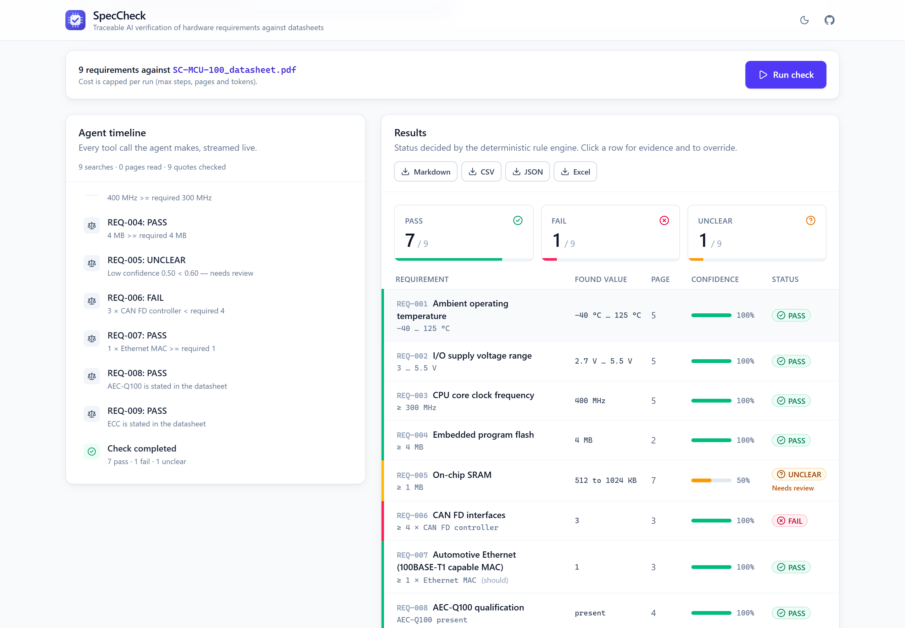
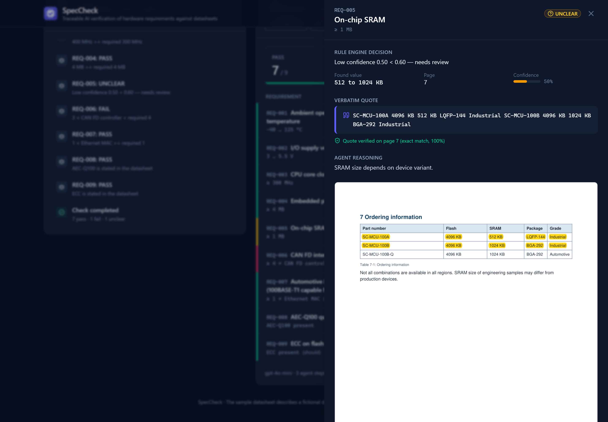
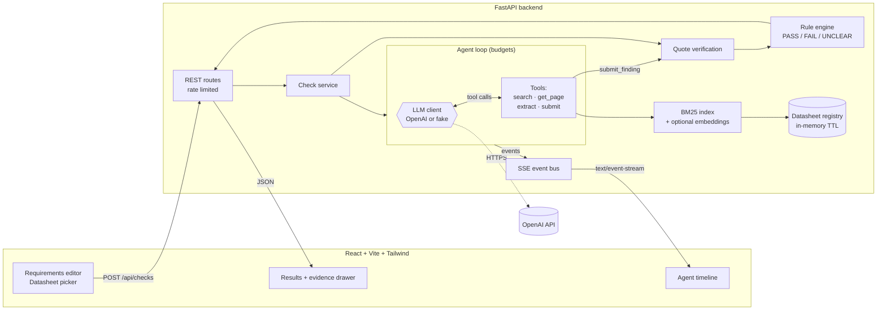

<div align="center">


# SpecCheck

**An AI agent that verifies hardware requirements against component datasheets, with every result traceable to a page and a verified quote.**

*The LLM finds and extracts. Python decides. A human reviews.*

[](https://github.com/olegicks/SpecCheck/actions/workflows/ci.yml)


[Problem](#-the-problem) · [Screenshots](#-screenshots) · [Architecture](#-architecture) · [How the agent works](#-how-the-agent-works) · [Design decisions](#-design-decisions) · [Run locally](#-run-locally) · [Tests](#-tests) · [Security](#-security-notes)

</div>

---

## 🔍 The problem

Hardware engineers who select components for automotive embedded systems such as vehicle computers and zone controllers check requirement lists against datasheets that run to hundreds of pages. Typical checks:

- operating temperature −40 … +125 °C
- I/O supply voltage range
- CPU clock, flash and RAM size
- number of CAN FD controllers and Automotive Ethernet MACs
- AEC-Q100 qualification and ECC

This work is slow and error-prone. Values hide in tables, are given in mV instead of V or in KB instead of MB, sit in footnotes, or depend on the ordering variant.

**SpecCheck automates the search but keeps the engineer in control.** Every PASS or FAIL comes with a page number and a verbatim quote, and the quote is checked against that page automatically. Anything uncertain is marked **UNCLEAR** and flagged for review.

## 📸 Screenshots

<table>
<tr>
<td width="50%">

**Dashboard** (light mode). On the left, the live agent timeline streamed over SSE. On the right, the summary cards and the colour-coded results.



</td>
<td width="50%">

**Evidence drawer** (dark mode). The rendered PDF page with the quote highlighted, the verification status, the agent's reasoning and the human override form.



</td>
</tr>
</table>

## ✨ Features

| | |
|---|---|
| 🧾 **Requirements editor** | Editable table with inline validation and reordering. Six requirement types (`range`, `min`, `max`, `equals`, `min_count`, `presence`). Comes with a *Vehicle Computer MCU* template and supports YAML/CSV import and export with row-numbered error messages. |
| 📄 **Datasheets** | A built-in fictional **SC-MCU-100** datasheet generated by a script in the repo, or PDF upload with drag and drop (max 10 MB / 80 pages, magic-byte check, kept in memory with a TTL, never written to disk). |
| 🤖 **Real LLM agent** | OpenAI tool calling (`gpt-4o-mini` by default) with `search_datasheet`, `get_page`, `extract_parameter` and `submit_finding`. Each run is capped in steps, tokens, time and pages read. |
| ⚖️ **Deterministic rule engine** | Pure Python with unit normalisation (°C, V/mV, Hz…GHz, B/KB/MB). It is the only component that can produce PASS, FAIL or UNCLEAR. |
| ✅ **Quote verification** | Each quote is matched against the cited page after unicode, hyphenation and whitespace normalisation, first exactly and then with a strict fuzzy match. Numbers are never fuzzy-matched. |
| 📡 **Live timeline** | Server-Sent Events with replay and `Last-Event-ID` resume, so every search, page read, extraction and verification appears as it happens. |
| 🧑‍🔧 **Human in the loop** | Overrides require a comment. The original agent result is kept and appears in every export. |
| 📤 **Exports** | Markdown, CSV, JSON and Excel (with protection against formula injection). |
| 🌗 **Polished UI** | Light and dark mode, a *Live LLM / Offline demo* badge, skeleton loaders, empty states, keyboard access and ARIA labels. |

## 🏗 Architecture



```
SpecCheck/
├── backend/
│   ├── app/
│   │   ├── core/          # rule engine, units, quote verification, requirement I/O (pure, no I/O)
│   │   ├── datasheets/    # PDF parsing & rendering, BM25 search, TTL store, sample generator
│   │   ├── agent/         # agent loop, tools, prompts, OpenAI client, fake/demo LLMs
│   │   ├── checks/        # run orchestration, SSE event bus, overrides, exports
│   │   ├── api/           # FastAPI routes
│   │   ├── config.py      # settings (env / .env), live vs offline mode
│   │   └── logging_utils.py  # secret redaction
│   ├── scripts/generate_sample_datasheet.py
│   ├── samples/           # generated fictional SC-MCU-100 PDF
│   └── tests/             # core, datasheets, agent, api, e2e, secrets
├── frontend/src/
│   ├── api/               # typed client + SSE subscription
│   ├── features/          # requirements · datasheet · timeline · results
│   ├── components/ hooks/ mocks/ test/
├── docker-compose.yml · render.yaml · .github/workflows/ci.yml
```

## 🤖 How the agent works

1. **Task prompt.** The agent receives the requirement list, the file name and the page count, but not the document itself.
2. **Search.** `search_datasheet(query, top_k)` runs BM25 over overlapping 80-word page chunks and returns at most one snippet per page. BM25 suits datasheets because they are full of exact tokens like `VDDIO`, `AEC-Q100` and `fCPU`.
3. **Read.** `get_page(n)` or `extract_parameter(requirement_id, page_numbers)` returns page text wrapped in `<datasheet_content page="n">…</datasheet_content>`.
4. **Submit.** `submit_finding(...)` is validated against a strict Pydantic schema: `requirement_id, value, unit, page, quote, confidence (0..1), notes`. The schema has **no status field**, so the model cannot pass or fail anything.
5. **Instant verification.** The quote is checked against the cited page straight away. If verification fails, the model gets a hint and up to two more attempts.
6. **Decide.** Once the loop ends, the rule engine evaluates every requirement. Requirements without a verified finding become UNCLEAR.

Guard rails in the loop:

| Limit | Default | Env var |
|---|---|---|
| Max agent steps | 40 | `SPECCHECK_AGENT_MAX_STEPS` |
| Max tokens per run | 150 000 | `SPECCHECK_AGENT_MAX_TOKENS` |
| Wall-clock timeout | 240 s | `SPECCHECK_AGENT_TIMEOUT` |
| Max pages read | 40 | `SPECCHECK_AGENT_MAX_PAGES` |
| Invalid tool calls before abort | 4 | – |
| Resubmissions per requirement | 3 | – |
| Concurrent runs | 4 | `SPECCHECK_MAX_CONCURRENT_RUNS` |

Invalid JSON or arguments are sent back to the model as an error so it can retry. Every step becomes a timeline event.

### The sample datasheet is deliberately tricky

`backend/scripts/generate_sample_datasheet.py` builds an 8-page PDF of the fictional **SC-MCU-100**, marked as fictional on every page:

| Req | Trap | Expected |
|---|---|---|
| REQ-001 Temperature | value appears **only in a table** | ✅ PASS |
| REQ-002 I/O supply | given in **mV** (2700 … 5500 mV) | ✅ PASS |
| REQ-004 Flash ≥ 4 MB | given as **4096 KB** | ✅ PASS |
| REQ-005 SRAM ≥ 1 MB | **depends on the variant** (512 KB vs 1 MB) | ❔ UNCLEAR |
| REQ-006 ≥ 4 CAN FD | only **3** controllers | ❌ FAIL |
| REQ-008 AEC-Q100 | mentioned **only in a footnote** | ✅ PASS |

An end-to-end test asserts these statuses for every preset requirement.

## 🧠 Design decisions

**Why does Python decide, not the LLM?**
LLMs are good at *finding* information in messy documents and unreliable at arithmetic, unit conversion and consistency. Splitting the job gives the following:
- **Determinism.** The same finding always produces the same status, so decisions are reproducible and auditable.
- **Testability.** The rule engine is pure and has 97% test coverage, including every requirement type and boundary.
- **Changing a threshold changes only the decision.** The extracted values stay the same; an e2e test proves this.
- **Prompt-injection resistance.** The model has no way to output PASS. The worst it can do is submit a wrong value, and that is caught by the next point.

**Why quote verification?**
A finding is only as good as its evidence. The quote must appear on the cited page, after normalising unicode (ligatures, minus signs, `℃`), soft hyphens, line-break hyphenation and whitespace. Exact matching is tried first, then a strict fuzzy match (≥ 92) for PDF-extraction noise. **Numbers are never fuzzy**: a fabricated "−40 to 125 °C" will not match a page that says "−20 to 85 °C". On top of that, the extracted value must appear in the quote, in any unit of the same dimension. This catches a correct quote paired with an invented number.

**Why a human override?**
Some answers can't be found in the document; "which variant do we order?" is a business decision. UNCLEAR is a first-class result that means "a human should look at this". Overrides require a comment and never replace the agent's result: both are stored and exported, so the report shows who changed what and why.

**Why is confidence a gate rather than the decision?**
The model's confidence below 0.6 (configurable) turns a result into UNCLEAR. It can push a result towards review, but it can never produce a PASS on its own.

**Why BM25 first, embeddings optional?**
It is free, deterministic, needs no API call and handles exact technical tokens well. Embedding re-ranking (`SPECCHECK_USE_EMBEDDINGS=true`) helps with paraphrased queries.

**Why can the fake LLM run the whole pipeline?**
`LLMClient` is a small protocol. The real OpenAI client, a `ScriptedLLM` for unit tests and a `DemoLLM` for offline mode all implement it. The whole agent, API and SSE stack is tested without network access, and the app still works without a key.

**Choices made where the spec was ambiguous** (simplest robust option):
- **KB vs KiB:** memory sizes use the JEDEC binary convention that semiconductor datasheets use, so `KB = KiB = 1024 B` and `MB = MiB = 1024² B`. "4096 KB" therefore satisfies "≥ 4 MB".
- **Range requirements:** the datasheet range must *cover* the required range (`found_min ≤ req_min` and `found_max ≥ req_max`).
- **A value range for `min`/`max`/`equals`:** if the finding contains several numbers, the result is UNCLEAR (ambiguous) and no number is picked.
- **Presence not found:** "not mentioned" gives UNCLEAR. FAIL needs an explicit statement that the feature is absent.
- **State:** runs and uploads live in memory with a TTL. This needs a single process and nothing survives a restart; a database is on the roadmap.

## 🚀 Run locally

**Prerequisites:** Python 3.12+, Node 22+.

### 1. Configure the API key (optional)

Without a key the app starts in **Offline demo** mode: a scripted agent replays a realistic run on the sample datasheet.

```powershell
# PowerShell
Copy-Item .env.example .env
notepad .env        # set OPENAI_API_KEY=sk-...
```

```bash
# bash
cp .env.example .env && $EDITOR .env
```

### 2. Backend

```powershell
# PowerShell
cd backend
python -m venv .venv
.\.venv\Scripts\Activate.ps1
pip install -e ".[dev]"
uvicorn app.asgi:app --reload --port 8000
```

```bash
# bash
cd backend
python3 -m venv .venv && source .venv/bin/activate
pip install -e ".[dev]"
uvicorn app.asgi:app --reload --port 8000
```

API docs: http://localhost:8000/docs

### 3. Frontend

```bash
cd frontend
npm install
npm run dev
```

Open http://localhost:5173. The Vite dev server proxies `/api` and `/health` to port 8000.

### Docker

```bash
docker compose up --build
```

The frontend runs at http://localhost:8080 (nginx, SSE-aware proxy) and the API at http://localhost:8000. Compose reads `.env` if it exists.

## 🧪 Tests

```bash
# backend (from backend/)
ruff check . && ruff format --check .
pytest --cov=app                                                       # 250 tests, ~96 % coverage
coverage report --include="app/core/*,app/agent/*" --fail-under=85      # core gate used in CI

# frontend (from frontend/)
npm run lint
npm run coverage                                                       # Vitest + Testing Library + MSW
```

| Area | What is covered |
|---|---|
| Rule engine | every requirement type, boundaries, unit conversion (mV, KB↔MB, GHz), unit mismatch, ambiguity, value-in-quote check, determinism |
| Verification | unicode, ligatures, soft and line-break hyphens, curly quotes, fuzzy tolerance, **changed numbers rejected** |
| PDF & search | sample page content, limits, corrupt/encrypted/scanned PDFs, rendering and highlighting, BM25 ranking, TTL store |
| Agent (fake LLM) | happy path, invalid JSON retries, schema violations, step/token/time/page budgets, LLM errors, nudging, resubmission limit, **prompt injection inside the PDF** |
| OpenAI client | request mapping and error mapping against a mocked HTTP transport (never the real API) |
| API | SSE replay and resume, uploads (size, type, pages), rate limits, concurrency cap, overrides, all export formats, crash containment |
| E2E | the full pipeline on the sample datasheet, with the expected status for every preset requirement |
| Secrets | the key never appears in responses, SSE events, exports, validation errors or logs |
| Frontend | requirements editor, status badges, results table, detail drawer, override form, upload, full app flow with mocked SSE |

An optional live smoke test calls the real API and only runs when you opt in:

```powershell
$env:SPECCHECK_LIVE_TESTS = "1"; pytest -m live
```

CI (GitHub Actions) runs linting, the backend tests with both coverage gates, and the frontend lint, tests and build on every push. It never calls the real API.

## ☁️ Deployment

- **Backend → Render:** `render.yaml` is a Docker-based blueprint. Set `OPENAI_API_KEY` and `SPECCHECK_CORS_ORIGINS` (your Vercel URL) as secrets in the dashboard.
- **Frontend → Vercel:** set the project root to `frontend/` and the environment variable `VITE_API_URL=https://<your-render-app>.onrender.com`.

## 🔐 Security notes

- The OpenAI key is read **only** from the `OPENAI_API_KEY` environment variable, loaded from a local `.env` for development. It is never hard-coded. `.env` is listed in `.gitignore` and `.dockerignore`, and only `.env.example` with placeholders is committed. A test checks this.
- The key is held as a Pydantic `SecretStr`. A global log-record factory redacts known secrets plus `sk-…` and `Bearer …` patterns from every log record and traceback. API errors are mapped to friendly messages without chaining the original exception, which can echo the key.
- Agent events (which can contain model output) and validation errors are redacted before they leave the server.
- Datasheet text is treated as **untrusted data**. It is delimited in tool output, attempts to close the delimiter are neutralised, instruction-like text raises a timeline warning, and the model cannot set a status in any case.
- Uploads are checked by magic bytes, size and page count, kept in memory only, and expire after 30 minutes. Rate limits (slowapi) and a concurrency cap limit cost and abuse.

## ⚠️ Limitations

- **Scanned PDFs** (images only) are rejected because there is no OCR.
- **Complex tables** come out as plain text; merged cells or rotated headers can confuse extraction. Quote verification limits the damage, but some of these results end up UNCLEAR.
- Conditional specs ("125 °C at reduced frequency") rely on the model's notes and confidence. The rule engine does not model conditions.
- State is in memory: one process, no persistence or authentication.
- The live agent is non-deterministic. The rule engine is deterministic, but what gets extracted can vary between runs. On the sample datasheet, `gpt-4o-mini` reproduces the expected statuses in most runs (about 14k tokens per run). The typical deviation is an overly cautious confidence that turns a FAIL into UNCLEAR, which is the safe direction because it asks for review rather than giving a wrong verdict.

## 🗺 Roadmap

- [ ] OCR fallback for scanned datasheets (e.g. Tesseract) and table-structure extraction
- [ ] Persistent storage (PostgreSQL) and user accounts with an audit trail for overrides
- [ ] Comparing several candidate components side by side
- [ ] Conditional requirements (temperature-dependent clock, voltage-dependent current)
- [ ] An evaluation set of real datasheets with precision/recall tracking per model
- [ ] Pluggable LLM providers (Azure OpenAI, local models)

---

<div align="center">
<sub>The SC-MCU-100 datasheet is fictional and was generated for demonstration. Always have a qualified engineer review compliance decisions.</sub>
</div>
